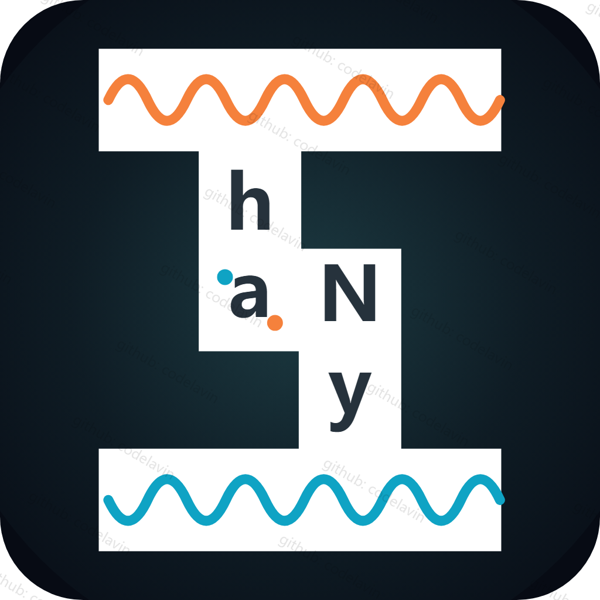

# han_any · 汉字描述模式
### 简介 · Introduction

han_any 的标识由 han 与 any 两个单词组合而成，配以橙色与蓝色两条波浪线。

The han_any mark is formed by combining the two words "han" and "any", accompanied by two wavy lines, one orange and one blue.

用汉字的信息交互便利，来描述事物的示例（现在已有 logo 的样式）。

It describes examples of things by way of the convenience of information exchange in Chinese characters (the logo above shows the current form).